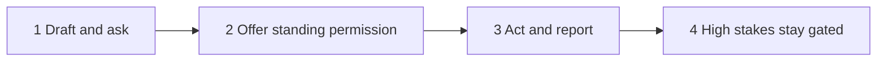
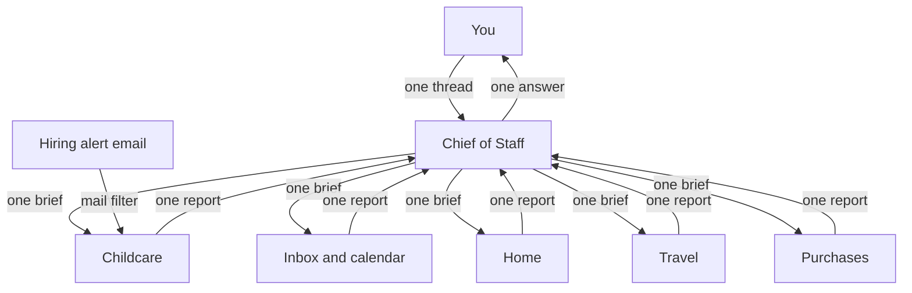
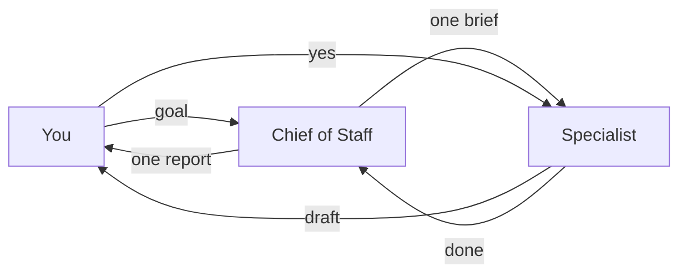
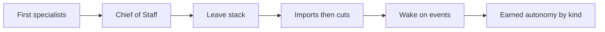

# How I run a team of Grok Bots

I got tired of one chat that tried to do everything. So I split the work across specialists and made one of them the only person I talk to day to day.

The center of it is earned autonomy. Every bot starts by drafting. Nothing goes out without my yes on that exact item. As a bot proves itself on a kind of task, it earns room to handle that kind on its own and report after. Trust is per kind of task, not a blanket for the bot. Agent authors, human approves.

This repo is that setup: paste-ready prompts, a team shape, and scrubbed stories of how each bot earned its place. Copy what you need, fill the placeholders, keep it lean. Normally I'd build something like this with Claude Code. I'm technical, so that part's easy for me. But this is at a level my parents could set up. I describe the job in plain English and it builds the bot.

One Chief of Staff is my single contact. It briefs the right specialist in one short note and reports back once. Specialists each own one job. Wake on real events when you can. Don't poll. Cut before you add.

**[Start your own team in 10 minutes →](QUICKSTART.md)**

## The autonomy ladder

Every new kind of work starts at draft-and-ask. Trust moves up one kind of task at a time.

1. **Draft and ask.** The bot writes the draft. I approve the send, payment, post, or change. This is the default for every new kind of work.
2. **Offer standing permission.** After it has done the same reversible thing my way a few times, it asks: "OK if I just handle this kind of thing from now on?"
3. **Act and report.** Once I say yes for that kind, it does the work and tells me afterward. No per-item ping for that kind.
4. **Still gated.** Payments, deletions, production changes, first messages to new people, and anything irreversible or high-stakes stay on a per-item yes until I grant that kind explicitly.

Trust is earned **per task type**, not as a blanket for the bot. A travel bot that may quietly watch the mailbox still needs my yes to change a calendar event or book a hotel.

Mermaid source

## The shape

Mermaid source

Handoff mermaid source

One **Chief of Staff** is my single contact. I tell it what I need. It briefs the right specialist in one short note, waits for that specialist to finish, and reports back once. I do not juggle twenty threads.

Travel was one of the first handoffs. The rest grew as I needed them, then got cut when imports overlapped.

## Roster

Heavy means real daily traffic. Active means regular routines or frequent briefs. Light means on request. Thin or parked means little or no real work yet. Folded or retired means the useful parts moved elsewhere. Autonomy notes live in each story.

### Home and family

| Bot | Use | One-line story |
|---|---|---|
| [Childcare](stories/childcare.md) | Heavy | Hiring help at home. Wakes on hiring-site alert email instead of polling. |
| [Travel](stories/trips.md) | Active | Early handoff. Flights, hotels, day-before briefs; flags calendar mismatches. |
| [Inbox and calendar](stories/inbox-and-calendar.md) | Active | Morning triage. Ranked list of what needs me. Absorbed family logistics. |
| [Purchases](stories/purchases.md) | Active | Find, compare, buy. Absorbed the watch-list hunt. |
| [Home](stories/home.md) | Moderate | Organizing, cleaners, appliance fixes. Drafts only. |
| [Expense Manager](stories/expense-manager.md) | Light | Logs receipts. Summaries when I ask. Never pays. |

### Building and writing

| Bot | Use | One-line story |
|---|---|---|
| [Brand](stories/brand.md) | Heavy | Personal drafts for X and LinkedIn, plus inbound triage. Stops before anything goes live. |
| [Engineer](stories/engineer.md) | Heavy when coding | Front door to Claude Code on my Mac. Stops before push or deploy without my yes. |
| [Grok Bot](stories/grok-bot.md) | Active | Flexible spare for research and one-offs. |
| [Proto Bot](stories/proto-bot.md) | Thin / parked | Idea-to-prototype drafts. Hidden until I am back from leave. |

### Meta

| Bot | Use | One-line story |
|---|---|---|
| [Chief of Staff](stories/chief-of-staff.md) | Heavy | The only day-to-day contact. Routes, synthesizes, stays quiet when idle. |
| [dr eggbot](stories/dr-eggbot.md) | Active on audits | Owns bot audits and description rewrites. |

### Archive or experiments

| Bot | Use | One-line story |
|---|---|---|
| [Tradbot](stories/tradbot.md) | Folded | Household habits moved into Inbox and calendar. |
| [Watches](stories/watches.md) | Folded | Listing hunt moved into Purchases. |
| [Alfred](stories/alfred.md) | Retired | First org audit. Overlapped dr eggbot. Hid itself. |
| [Daily Briefing Writer](stories/daily-briefing-writer.md) | Retired | Overlapped the morning digest. |
| [Social Media Manager](stories/social-media-manager.md) | Retired | Voice notes moved into Brand. |

## How the team grew

Growth mermaid source

Relative order only. No personal dates.

1. **First specialists.** Travel was one of the earliest handoffs. Shopping and a few other wizards existed before a single front door.
2. **Chief of Staff.** I made one bot the only day-to-day contact. Draft only. One brief in, one report out.
3. **Leave stack.** Childcare, Inbox and calendar, Home, Travel, and Purchases covered the boring parts of life while I was on parental leave. Brand and Engineer joined for writing and building.
4. **Imports, then cuts.** A wave of marketplace bots arrived. Some were useful. Many overlapped. Habits folded into the bots that already owned the lane. Duplicates hid or retired.
5. **Wake on events.** Childcare stopped polling. A mail filter forwards hiring alerts into its inbox. Same pattern works for shipping and airline changes.
6. **Earned autonomy, by kind.** Quiet watches and digests got standing permission first. Childcare earned first-round screening questions to new applicants under per-candidate send rules. Payments, posts, bookings, invites, declines, offers, and other first contacts stayed on a per-item yes.

## Why this works

1. **One bot, one job.** A narrow role keeps context useful. A general helper that also books flights and also hires childcare will forget half of it.
2. **Earned autonomy, starting from draft-only.** Every new kind of task starts as draft and ask. After the bot does that kind well, it can ask to handle it going forward. Trust is per task type.
3. **Wake on real events.** Do not poll. Forward alert emails to the bot's inbox so each new message wakes it.
4. **Cut before you add.** If an existing bot only needs a new habit, give it a skill or a routine instead of a sibling.

## The rules that keep me sane

**Draft only by default.** Bots draft. I send. Nothing goes out without my yes on that exact item, unless that kind of task has earned standing permission.

**Earned autonomy, by kind of task.** After a bot has done the same reversible thing a few times the way I like, it asks: "OK if I just handle this kind of thing from now on?" Once I say yes for that kind, it acts and reports afterward. Irreversible or high-stakes things still need a yes every time until I grant that kind explicitly.

**One brief in, one report out.** Specialists do not chatter at me. The Chief of Staff is the only day-to-day contact.

**Owns / does not own.** Every prompt names what it owns and what it must refuse. The "does not own" list is what stops sprawl.

## How the hiring alerts wake a bot

I do not have a bot poll the hiring site. A mail filter on my personal inbox forwards that site's alert emails to the childcare bot's own inbox. Each new forwarded message wakes the bot. It reads the alert, drafts the next step, and waits for my yes. Same pattern works for shipping notices, airline changes, or anything else that already arrives as email.

## Quick start

Short path: **[QUICKSTART.md](QUICKSTART.md)**.

1. Create one Chief of Staff. Paste [`prompts/chief-of-staff.md`](prompts/chief-of-staff.md).
2. Add a first specialist (Travel is a good first one). Paste [`prompts/travel.md`](prompts/travel.md).
3. For any other role, copy [`prompts/_template.md`](prompts/_template.md) or an existing file in [`prompts/`](prompts/).
4. Say the draft-only rule and the earned-autonomy ladder out loud in the first chat.
5. Read [`stories/`](stories/) if you want how each role earned its place.

## What's in each prompt file

Every file in `prompts/` uses the same sections:

| Section | What it answers |
|---|---|
| **Owns / Does not own** | What it owns |
| **Source of truth** | Where facts come from; if it is not there, say so |
| **Needs approval for** | The human gates. Start at draft-only. Standing permission is per kind of task. |
| **Triggers / Outputs** | What starts it, what it hands back |
| **Handoffs** | Which teammate gets what |
| **Role description** | Paste-ready text with `<placeholders>` |

## How to adapt this

- Cut the roster before you add to it. If an existing bot only needs a new habit, give it a skill or a routine instead of a sibling.
- When you correct a bot, write the general rule into its description, not the story of what went wrong today.
- Keep irreversible actions on a per-item yes until you grant that kind explicitly.
- Be honest about thin bots. A parked specialist is fine. A second bot that does the same job is not.

The prompts are templates, not magic. The insight is the shape: one front door, specialists, earned autonomy from a draft-only start, wake on real events, and cut what overlaps.
